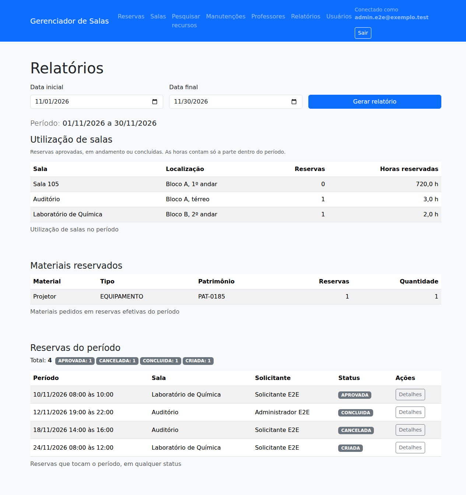
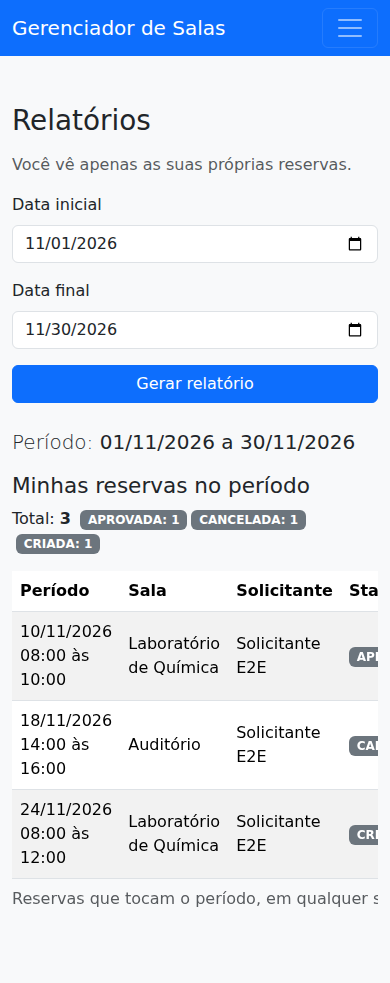

# Evidência de validação: Issue #185 (ENT-03)

A issue #185 consolida a base de interface (antiga #45), professores e competências (antiga #62) e os relatórios (antiga #43). A entrega foi feita em três PRs, todos com o Maven Verify verde.

## Entregas

| PR | Parte | Conteúdo |
|---|---|---|
| #211 | Base de interface | Cabeçalho comum em todas as telas autenticadas, com menu por perfil (Aprovações só para RESPONSAVEL; Usuários e Salas só para ADMINISTRADOR), usuário conectado e botão Sair com volta ao login; estado de carregamento ("Processando...") nos formulários |
| #212 | Relatórios | Tela `/relatorios` com filtro de período, utilização de salas e materiais, reservas do período com totais por status, estados de erro, vazio e falha |
| #213 | Professores, competências e validação | Tela de competências do professor, mensagens em português, estados vazio e de falha na lista; testes E2E e capturas reais publicadas pela CI |

## Decisões de projeto

| Tema | Decisão | Motivo |
|---|---|---|
| Menu por perfil | `MenuDoUsuarioAdvice` monta o menu no servidor, sem `thymeleaf-extras-springsecurity` | Compatibilidade garantida com o Spring Boot 4; a autorização real continua no `SecurityConfig` e nos controllers |
| Período do relatório | Datas inteiras e inclusivas, no fuso America/Sao_Paulo, com no máximo 366 dias; sem filtro, o mês atual | Período explícito pedido pelo RF-12 e consulta com custo limitado |
| Utilização | Conta reservas APROVADA, EM_ANDAMENTO e CONCLUIDA; as horas são recortadas ao período | Reserva cancelada, rejeitada ou ainda pendente não ocupa a sala; uma reserva que atravessa o limite não infla o total |
| Visão por perfil | Responsável e Administrador veem tudo; o Solicitante vê só as próprias reservas e não recebe os relatórios de salas e materiais | Os relatórios de uso juntam dados de outros solicitantes |
| Competências | Inclusão e remoção uma a uma, normalizadas em minúsculas; repetida, vazia, longa ou ausente gera erro com o texto preservado | Feedback claro em vez de alteração silenciosa |

## Critérios de aceite

| Critério | Como foi atendido | Teste |
|---|---|---|
| Navegação, cabeçalho e feedback padronizados | Fragmento `fragmentos/layout.html` em todas as telas autenticadas | `NavegacaoWebIntegrationTest`, `NavegacaoNavegadorTest` |
| Ações administrativas escondidas de perfil indevido | Itens do menu e botões condicionados ao perfil, além do 403 no servidor | `NavegacaoWebIntegrationTest`, `ProfessorCompetenciasWebControllerTest`, `ProfessoresNavegadorTest` |
| Desktop e mobile sem overflow | Tabelas em `table-responsive`, grade do Bootstrap e conferência da largura do conteúdo | `NavegacaoNavegadorTest`, `RelatoriosNavegadorTest`, `ProfessoresNavegadorTest` (celular, tablet e desktop) |
| Professores: listar, criar, editar e inativar conforme autorização | Telas existentes, com mensagens em português e erro ao desativar professor inexistente | `ProfessorWebControllerTest`, `ProfessorCompetenciasWebControllerTest`, `ProfessoresNavegadorTest` |
| Incluir e remover competências com validação e feedback | Tela `/professores/{id}/competencias` | `ProfessorCompetenciasServiceTest`, `ProfessorCompetenciasWebControllerTest`, `ProfessoresNavegadorTest` |
| Estados vazio, carregamento, falha e dados | Mensagens próprias para lista vazia e filtro sem resultado, aviso de falha do banco, "Processando..." nos envios | `ProfessorCompetenciasWebControllerTest`, `RelatorioWebIntegrationTest` |
| Impedir gravação inválida e preservar o preenchimento | Validação no servidor antes de gravar e campos devolvidos com o valor digitado | `ProfessorCompetenciasWebControllerTest`, `RelatorioWebIntegrationTest` |
| Relatórios de utilização de salas, materiais e reservas com filtro de período | `RelatorioService` com consultas agregadas no PostgreSQL | `RelatorioWebIntegrationTest`, `RelatoriosNavegadorTest` |
| Validar o período | Data vazia, inválida, invertida ou acima de 366 dias é recusada | `PeriodoRelatorioTest`, `RelatorioWebIntegrationTest` |
| Tratar relatório vazio | Mensagens de nenhuma sala, nenhum material e nenhuma reserva no período | `RelatorioWebIntegrationTest` |
| Respeitar autorização sem expor dados de outros solicitantes | Filtro por e-mail na consulta do Solicitante e relatórios de uso só para perfis operacionais | `RelatorioWebIntegrationTest`, `RelatoriosNavegadorTest` |

## Capturas reais

Geradas pelo `CapturasDeTelaNavegadorTest` no Chrome sem interface gráfica, com a aplicação completa e PostgreSQL em container. A CI publica as imagens como o artefato `capturas-de-tela` do run. As cópias abaixo vêm do run [42945878207](https://github.com/pedrobertanhi/GerenciadorDeSalas/actions/runs/42945878207), commit `1643d86`.

| Tela | Celular (390 px) | Tablet (768 px) | Desktop (1280 px) |
|---|---|---|---|
| Reservas (Administrador) | [ver](capturas/ISSUE-185/celular-01-reservas.png) | [ver](capturas/ISSUE-185/tablet-01-reservas.png) | [ver](capturas/ISSUE-185/desktop-01-reservas.png) |
| Professores (Administrador) | [ver](capturas/ISSUE-185/celular-02-professores.png) | [ver](capturas/ISSUE-185/tablet-02-professores.png) | [ver](capturas/ISSUE-185/desktop-02-professores.png) |
| Competências do professor | [ver](capturas/ISSUE-185/celular-03-competencias.png) | [ver](capturas/ISSUE-185/tablet-03-competencias.png) | [ver](capturas/ISSUE-185/desktop-03-competencias.png) |
| Relatórios (Administrador) | [ver](capturas/ISSUE-185/celular-04-relatorios-administrador.png) | [ver](capturas/ISSUE-185/tablet-04-relatorios-administrador.png) | [ver](capturas/ISSUE-185/desktop-04-relatorios-administrador.png) |
| Relatórios com período inválido | [ver](capturas/ISSUE-185/celular-05-relatorios-periodo-invalido.png) | [ver](capturas/ISSUE-185/tablet-05-relatorios-periodo-invalido.png) | [ver](capturas/ISSUE-185/desktop-05-relatorios-periodo-invalido.png) |
| Relatórios sem dados | [ver](capturas/ISSUE-185/celular-06-relatorios-vazio.png) | [ver](capturas/ISSUE-185/tablet-06-relatorios-vazio.png) | [ver](capturas/ISSUE-185/desktop-06-relatorios-vazio.png) |
| Professores (Solicitante) | [ver](capturas/ISSUE-185/celular-07-professores-solicitante.png) | [ver](capturas/ISSUE-185/tablet-07-professores-solicitante.png) | [ver](capturas/ISSUE-185/desktop-07-professores-solicitante.png) |
| Relatórios (Solicitante) | [ver](capturas/ISSUE-185/celular-08-relatorios-solicitante.png) | [ver](capturas/ISSUE-185/tablet-08-relatorios-solicitante.png) | [ver](capturas/ISSUE-185/desktop-08-relatorios-solicitante.png) |

## Execução na CI

| PR | Commit | Run | Resultado |
|---|---|---|---|
| #211 | 666d181 | Maven Verify do PR | verde |
| #212 | 7ab2101 | Maven Verify do PR | verde |
| #213 | 1643d86 | [42945878207](https://github.com/pedrobertanhi/GerenciadorDeSalas/actions/runs/42945878207) | 898 testes, 0 falhas, 0 erros, 0 ignorados, incluindo os E2E no navegador e as capturas |

Comando: `./mvnw --batch-mode --no-transfer-progress verify`, Java 21 e PostgreSQL em container (Testcontainers).

## Roteiro de validação manual

1. Entrar como ADMINISTRADOR: o menu mostra Salas e Usuários, e não mostra Aprovações. Entrar como RESPONSAVEL: mostra Aprovações, e não Salas nem Usuários.
2. Em **Professores**, cadastrar um professor sem competências e depois tentar outro com o mesmo e-mail: aparece "Este e-mail já está cadastrado." e o formulário mantém os dados.
3. Em **Competências**, incluir "Química", tentar "QUÍMICA" (erro de repetida) e remover a competência.
4. Desativar o professor: ele some da lista, que mostra "Nenhum professor cadastrado." se for o único.
5. Em **Relatórios**, gerar o mês atual, depois um período invertido (erro) e um período sem reservas (estado vazio).
6. Entrar como SOLICITANTE: os relatórios mostram só as próprias reservas, sem utilização de salas nem materiais.
7. Reduzir a janela para 390 px e 768 px: o menu recolhe, as tabelas rolam dentro do próprio quadro e a página não rola na horizontal.
8. Clicar em **Sair**: volta ao login com "Você saiu do sistema."

## Pendências fora do escopo

- RF-12 também prevê carga docente e conflitos evitados. A #185 pediu salas, materiais e reservas; os outros dois indicadores ficam para issue própria.
- Exportação dos relatórios (CSV ou PDF) não foi pedida.
